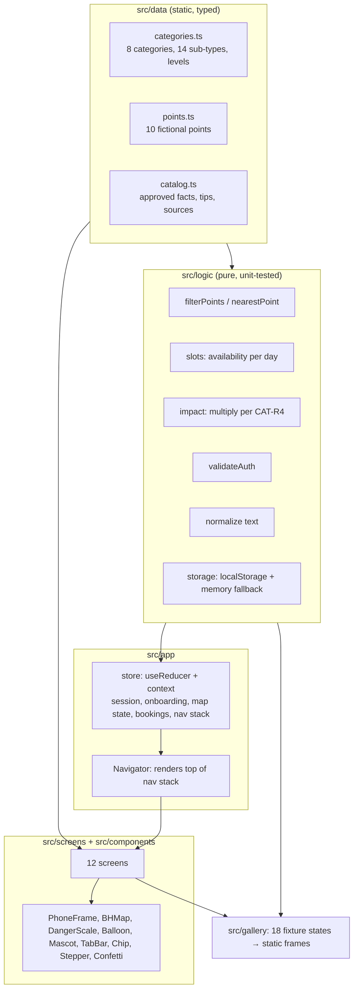

# recicla-E Prototype Design

**Spec**: `.specs/features/recicla-e-prototype/spec.md` (rev. 3, approved)
**Research**: `.specs/features/recicla-e-prototype/research.md`
**Status**: Draft

---

## Architecture Overview

Vite + React + TypeScript app built into **two self-contained HTML files** (`dist/index.html`, `dist/gallery.html`) with `vite-plugin-singlefile`. Everything (JS, CSS, SVG) is inlined, so both files open from disk with no network (NFR-01, NFR-02 as amended by AD-001).

The plugin supports one entry per build, so `npm run build` runs Vite twice (`--mode app`, `--mode gallery`) into the same `dist/`.



**Key idea for GAL-02:** every screen is a pure component `(props) → JSX` that receives state and callbacks. `index.html` feeds them from the live store; `gallery.html` feeds them from 18 fixed fixtures with no-op callbacks. No screen reads global state directly.

---

## Code Reuse Analysis

Greenfield: the project folder holds only `.specs/`. There is no existing code to reuse.

| Source | How it's used |
| ------ | ------------- |
| `research.md` §0–§10 | Content for `catalog.ts` and the levels in `categories.ts` (each entry carries a `researchRef`) |
| `research.md` §11 | Exclusion list. A unit test asserts no catalog text matches these claims (NFR-03, CAT-R2) |

### Integration Points

None. There's no backend. The only external surface is `localStorage`.

---

## Components

### Data layer: `src/data/`

- **categories.ts**: `CATEGORIES: Category[]`, `SUBTYPES: Subtype[]`, `categoryLevel(id)`. The category level is the highest sub-type level, computed rather than hard-coded.
- **points.ts**: `POINTS: Point[]` exactly as in the spec's Mock Data, plus SVG map coordinates.
- **catalog.ts**: `SOURCES`, `FACTS`, `TIPS`, `GUIDES` (per sub-type: porQueNaoGuardar, comoDescartar, stream, comoLevar, danoAmbiental), `LEVEL_JUSTIFICATION`, `MULTIPLIABLE` (exactly the 5 values of CAT-R4).

### Logic layer: `src/logic/` (pure functions, no React)

| Module | Interface | Spec |
| ------ | --------- | ---- |
| `normalize.ts` | `normalize(s: string): string` (lowercase, strip accents) | MAP-09, EDGE-03 |
| `filter.ts` | `pointAcceptsCategory(p, catId)`, `filterPoints(points, {categories, query}): Point[]` (sorted by distance, then name) | MAP-08..11 |
| `nearest.ts` | `nearestPointFor(catId, points): Point \| undefined` | ONB-09, EDGE-02 |
| `mapState.ts` | `applyHandoff(state, handoff)`, `toggleChip(state, catId)`, `selectAll(state)`, `clearFilters(state)` | MAP-02..07, MAP-13 |
| `slots.ts` | `nextSevenDays(now)`, `isOpen(point, date)`, `slotsFor(point, date, now): string[]` | SCH-03..05 |
| `impact.ts` | `impactFor(items: {subtypeId, qty}[]): ImpactLine[]`, `sumImpact(bookings)` | SCH-09..11, PROF-06..07 |
| `auth.ts` | `validateLogin(email, pw)`, `validateSignup(nome, email, pw)` → field-error map; `nameFromEmail(email)` | AUTH-04..06, AUTH-10..11 |
| `storage.ts` | `createStorage(backend?)` → `{load(): Persisted, save(p), clear()}`, falls back to memory if `localStorage` throws | EDGE-01, PROF-03..05 |
| `format.ts` | `km(n)` → "0,8 km", `grams(n, unit)`, pt-BR dates | MAP-11 |

### App layer: `src/app/`

- **store.tsx**: `AppState`, `reducer(state, action)`, `AppProvider`, `useApp()`. Actions: `login`, `signup`, `logout`, `resetDemo`, `answerCard`, `skipOnboarding`, `navigate(screen, params)`, `back()`, `setMap(...)`, `book(booking)`. The reducer is pure and unit-tested. Persistence runs in an effect through `storage.ts`.
- **clock.ts**: `ClockContext` providing `now()`. Production uses `Date.now`; tests use Playwright's `page.clock` and unit fixtures. This keeps slots deterministic.
- **Navigator.tsx**: renders the screen on top of `state.nav` (a stack of `{screen, params}`). It hides the TabBar on non-main screens and during onboarding (ONB-03, NAV-01).

### UI: `src/components/`

| Component | Purpose | Spec |
| --------- | ------- | ---- |
| `PhoneFrame` | 390×844 rounded device frame, status bar, scroll area | — |
| `BHMap` | Illustrated SVG of BH (Lagoa da Pampulha, Serra do Curral, main avenues), user dot, pins, optional dashed route; `mini` variant | MAP-01, ONB-10, PT-06 |
| `DangerScale` | 5 segments, emoji and label; tap opens a Balloon with the justification and the scale note | SCALE-01..03 |
| `Balloon` | Speech bubble that closes on ✕ or on an outside tap | TIP-02..04 |
| `InfoIcon` | ⓘ trigger for a Balloon with a catalog fact | TIP-03 |
| `Mascot` | "Reci" inline SVG with 3 poses: idle, talking, celebrating | TIP-01, SCH-08 |
| `SwipeCard` | Pointer-event drag with a threshold of ±100 px, exit animation, and a `locked` flag during the animation | ONB-04..07 |
| `TabBar`, `Chip`, `Button` (3D Duolingo style), `Stepper`, `Confetti` (CSS-only), `FonteNote`, `FictionalBadge` | Shared UI | various |

### UI: `src/screens/`

`Login`, `Signup`, `Onboarding`, `OnboardingSummary`, `HomeMap`, `PointDetail`, `RouteView`, `Schedule`, `Celebration`, `Learn`, `DevicePage`, `Profile`. Each screen receives props only (state slice plus callbacks).

### Gallery: `src/gallery/`

- **fixtures.ts**: 18 `{id: 'S1'..'S18', name, render: () => JSX}` entries built from real data, with a fixed clock of 2026-11-16 10:00, a Monday.
- **Gallery.tsx**: a grid of captioned `PhoneFrame`s, "S# — name" (GAL-01).

---

## Data Models

```ts
type CategoryId = 'pilhas'|'baterias'|'celulares'|'computadores'|'linhabranca'|'tvs'|'lampadas'|'cabos'
type Level = 1|2|3|4|5

interface Subtype { id: string; categoryId: CategoryId; label: string; level: Level; emoji: string }
interface Category { id: CategoryId; label: string; emoji: string }   // level derived

interface Hours { days: number[] /*0=Dom..6=Sáb*/; open: number; close: number }  // hours, integer
interface Point {
  id: number; name: string; neighborhood: string; address: string; phone: string
  distanceKm: number; accepts: string[] /*subtype ids*/; hours: Hours[]; map: { x: number; y: number }
}

interface Source { id: string; name: string; url: string }
interface Fact {
  id: string; text: string; subtypes: string[]; sourceId: string; researchRef: string  // e.g. "§5 tabela linha 2"
  perUnit?: { value: number; unit: 'mg'|'g'|'kg'; substance: string; qualifier: 'cerca de'|'até' }
}
interface Guide { subtypeId: string; porQueNaoGuardar: string; comoDescartar: string; stream: string; comoLevar: string; danoAmbiental: string; factIds: string[] }

interface MapState { categories: CategoryId[] /* [] = Todos */; query: string }
type Handoff = { kind: 'category'; categories: CategoryId[] } | { kind: 'reset' }

interface Booking { id: string; pointId: number; items: { subtypeId: string; qty: number }[]; date: string /*YYYY-MM-DD*/; slot: string /*"09:00"*/ }

interface Persisted {               // localStorage key "recicla-e:v1"
  session: boolean; name?: string
  onboarding: { done: boolean; answers: Partial<Record<CategoryId, 'tenho'|'nao'>> }
  bookings: Booking[]
}
interface AppState extends Persisted { map: MapState; nav: { screen: ScreenId; params?: unknown }[]; tipDismissed: boolean }
```

---

## Error Handling Strategy

| Scenario | Handling | User impact |
| -------- | -------- | ----------- |
| `localStorage` throws or is unavailable | `storage.ts` switches to an in-memory backend | Works; state lost on reload (EDGE-01) |
| Corrupt or old saved JSON | `load()` validates its shape; on failure it returns defaults and overwrites | Starts fresh at login |
| Invalid form | Field-error map shown inline | AUTH-04..06 |
| No points match | Empty state | MAP-12 |
| No slots for a day | Empty slots message | SCH-05 |
| Double swipe during the animation | `SwipeCard` is locked until `onExitEnd` | ONB-07 |

---

## Risks & Concerns

| Concern | Location | Impact | Mitigation |
| ------- | -------- | ------ | ---------- |
| `vite-plugin-singlefile` supports only one HTML entry (README: multi-entry is `wontfix`) | `vite.config.ts` | Can't build both files in one pass | Two builds selected by `--mode` and `emptyOutDir: false` on the second; e2e test asserts both files exist and load offline |
| Toolchain majors are very recent (Vite 8, TS 7, Vitest 5); compatibility between them isn't proven | `package.json` | Setup may fail | T1 is a smoke task: if the scaffold build fails, pin to the previous majors and record it in tasks.md |
| Playwright needs a Chromium download (~150 MB) | dev machine | First run is slow or blocked | T1 runs `npx playwright install chromium` and reports any failure |
| Swipe gestures are flaky in e2e | `SwipeCard` | Flaky tests | Tests use the ✅/✕ buttons for flow and one dedicated drag test with `page.mouse` |
| Time-dependent slots | `slots.ts` | Nondeterministic tests | Clock is injected; Playwright uses `page.clock.setFixedTime` |
| Educational content drifts from the research | `catalog.ts` | Misinformation | Every fact has `researchRef`; a unit test checks sources and §11 exclusions and that `MULTIPLIABLE` matches CAT-R4 exactly. The user reviews the content (UAT) |
| Unit-test files from a file:// e2e must not hit the network | e2e | NFR-01 false pass | Playwright routes `**/*` and fails the test on any non-`file:` request |

---

## Tech Decisions

| Decision | Choice | Rationale |
| -------- | ------ | --------- |
| Stack | Vite 8 + React 19 + TypeScript + `vite-plugin-singlefile` | User choice (AD-001) |
| Routing | In-memory nav stack in the store, no URL router | Works over file://; back behaviour is explicit (NAV-02, PT-08) |
| State | `useReducer` + context; no state library | Small app; the pure reducer is unit-testable |
| Styling | Plain CSS with variables (one `theme.css` + per-component CSS) | Survives html.to.design import better than CSS-in-JS runtime classes |
| Map | Hand-drawn SVG component; point coordinates in `points.ts` | User chose illustrated; offline |
| Unit tests | Vitest (logic, reducer, catalog) | Native to Vite |
| E2E | Playwright (Chromium) against `file:///…/dist/index.html` and `gallery.html` with network blocked | Tests the actual deliverable |
| Lint | `tsc --noEmit` as the static gate; no ESLint | Keeps setup small; types catch most errors in a prototype |

---

## Spec Amendment (from AD-001)

NFR-02 becomes: *"The built `dist/index.html` and `dist/gallery.html` SHALL each work when opened directly from disk; producing them requires `npm run build`."*
